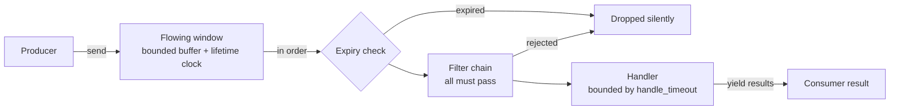

<div align="center">

# Bitongue

An async message flowing library built on anyio and msgspec

[中文](README.md) **·** [English]

[](https://github.com/Ahsen17/bitongue/actions/workflows/pytest.yml)
[](LICENSE)
[](pyproject.toml)

</div>

---

## Contents

[About](#about) **·** [Features](#features) **·** [Installation](#installation) **·** [Quick start](#quick-start) **·** [Architecture](#architecture) **·** [Development](#development) **·** [Documentation](#documentation) **·** [Contributing](#contributing) **·** [License](#license)

## About

Bitongue - A message flowing noting library.

Bitongue is an async message flowing library: producers put messages into an in-memory flowing window; consumers draw them in order, pass them through filters, and hand them to a handler that produces results. Messages and results are [msgspec](https://jcristharif.com/msgspec/) structs and the async primitives come from [anyio](https://anyio.readthedocs.io/) — the flowing window owns buffering and lifetime control, the filter chain owns admission, and the handler owns business logic, each evolving independently.

## Features

- **In-memory message flowing window**: a bounded buffer built on anyio memory streams, with a configurable window size and message lifetime; expired messages are dropped automatically at consumption time, and rejected or expired messages never block the rest
- **Filter-chain admission**: messages pass through the filter chain before processing; a message is released only when every filter accepts it, and rejected messages are dropped silently
- **Built-in filters**: the keyword blocklist `KeywordsFilter` (Aho-Corasick with normalized matching) and duplicate interception via `SparseFilter` (qdrant sparse retrieval — similar to the corpus means rejected); filters implementing `FilterLifecycle` are started and stopped by the orchestrator
- **Handler extension point**: implement one async `handle(message) -> result` method to plug in your business logic, keeping flow mechanics decoupled from message processing
- **Two layers of timeout protection**: the flowing timeout bounds how long a message stays alive in the window, and the handle timeout caps how long a single message may take (a timeout actually cancels the in-flight work); timed-out messages are skipped without blocking the rest
- **Type-safe data structures**: messages and results are msgspec structs with built-in dict and JSON serialization, and generic parameters flow through from send to result
- **Layered dependencies**: the core (flowing window, orchestrator) depends only on anyio and msgspec; the built-in filters bring in domain dependencies such as fastembed, jieba, pyahocorasick, and qdrant-client

## Installation

```bash
# uv
uv add bitongue

# pip
pip install bitongue
```

Python ≥ 3.12 is required. If the package is not yet published to PyPI, install it from source:

```bash
uv add git+https://github.com/Ahsen17/bitongue.git
```

## Quick start

Define a filter (drops empty text) and a handler (uppercases text), send two messages, and consume the result:

```python
import anyio

from bitongue.client import Bitongue, BitongueConfig
from bitongue.filter import BaseFilter
from bitongue.flow import BaseMessage
from bitongue.handler import BaseHandler, BaseResult


class UpperResult(BaseResult):
    """The handling result: uppercased text."""

    text: str


class NonEmptyFilter(BaseFilter[BaseMessage]):
    """A filter that drops messages with empty text."""

    async def filter(self, message: BaseMessage) -> bool:
        return bool(message.text)


class UpperHandler(BaseHandler[BaseMessage, UpperResult]):
    """A handler that uppercases the text."""

    async def handle(self, message: BaseMessage) -> UpperResult:
        return UpperResult(text=(message.text or "").upper())


async def main() -> None:
    config = BitongueConfig(
        flowing_size=16,       # flowing window capacity (bounded buffer size)
        flowing_timeout=30,    # seconds a message stays alive in the window
        handle_timeout=5.0,    # per-message handling timeout in seconds
        handle_concurrency=1,  # handling concurrency (reserved field)
    )
    client = Bitongue(config, handler=UpperHandler(), filters=[NonEmptyFilter()])

    await client.start()
    await client.send(BaseMessage(type="text", text="hello bitongue"))
    await client.send(BaseMessage(type="text", text=""))  # dropped by the filter

    async for result in client.result():
        print(result.text)  # HELLO BITONGUE
        break  # the demo ends here; keep consuming as needed in real usage

    await client.shutdown()


if __name__ == "__main__":
    anyio.run(main)
```

Output:

```text
HELLO BITONGUE
```

For a step-by-step walkthrough, see [Quick start](https://ahsen17.github.io/bitongue/en/guide/quickstart.html) in the documentation site.

## Architecture



- **Production side**: `Bitongue.send()` wraps a message into an entry (recording its entry time and lifetime) and puts it into the bounded buffer; when the window is full the sender waits, creating backpressure.
- **Consumption side**: `Bitongue.result()` draws entries in order and first drops those past their lifetime; messages that pass the whole filter chain go to the handler under the `handle_timeout` bound, and timed-out messages are skipped; handler exceptions are wrapped as `MessageHandleError` and propagate to the consumer.

For the full structure and the life of a message, see [Architecture and data flow](https://ahsen17.github.io/bitongue/en/guide/architecture.html).

## Development

```bash
make install     # initialize the virtual environment and install dependencies
make check       # lint + type checks + all tests
make coverage    # coverage report (fail_under = 80)
make docs-build  # build the bilingual documentation site
```

Commit messages follow [Conventional Commits](https://www.conventionalcommits.org/en/); see [CONTRIBUTING_en.md](CONTRIBUTING_en.md) for details.

## Documentation

The full bilingual documentation site (quick start, core concepts, architecture, configuration):

- 简体中文: <https://ahsen17.github.io/bitongue/>
- English: <https://ahsen17.github.io/bitongue/en/>

## Contributing

Issues are welcome for bug reports and feature requests, and pull requests for changes. AI-assisted coding contributions are accepted, but contributors are fully responsible for the code they submit — see the [contributing guide](CONTRIBUTING_en.md).

## License

[AGPL-3.0](LICENSE)
